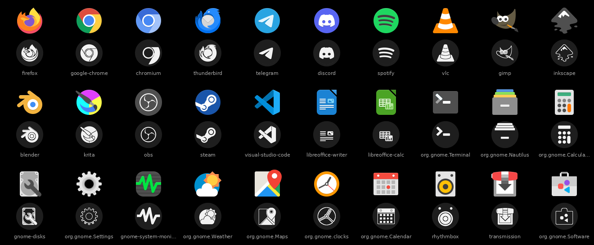
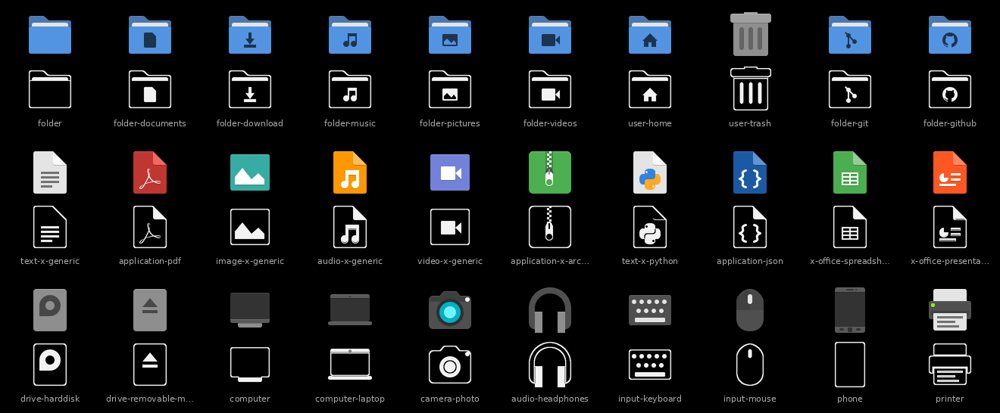

# DotStuff

**A Nothing-inspired black, white and red desktop for Linux Mint and other Cinnamon desktops,
installed and configured with one script, and undone with one more.**





> Unofficial fan project, not affiliated with or endorsed by Nothing Technology Limited.
> See [NOTICE.md](NOTICE.md) for credits.

## What you get

| Part | Details |
|---|---|
| **DotStuff theme** | Black windows and title bars, a black panel, menus and pop-ups, red accent, and a dot-matrix font for the panel clock, menus and calendar. Apps keep your normal font. Based on [Orchis](https://github.com/vinceliuice/Orchis-theme). |
| **Monochrome icons** | Two icon themes made by [monotile](vendor/monotile): **Monotile-Circle** and **Monotile-Squircle**. Apps and session icons become white stencils on dark tiles; folders and file types are Papirus in greyscale; devices and coloured status icons become white line art. New apps are converted automatically. |
| **Desktop widgets** | Five native Cinnamon desklets: clock (12-dot dial), date, weather, RAM/disk rings and a 24-dot day bar. Right-click > Configure to change them. |
| **Fonts** | Nothing's Ndot, NType 82 and Lettera Mono (from [xeji01/nothingfont](https://github.com/xeji01/nothingfont)), Space Mono/Grotesk and JetBrains Mono. |
| **Cursor** | [AOSP Cursors](https://github.com/Tech-Tac/aosp-cursors), Android's cursor set, at size 18. |
| **Wallpaper** | NothingWall, from [Panacea](https://github.com/EnsixD/Panacea). |
| **Menu button** | A white disc with a red centre dot. |
| **Bash prompt** (optional) | White `user@host`, red path. |

## Install

Linux Mint, Ubuntu or Debian, logged in to a **Cinnamon** session:

```sh
git clone https://github.com/<you>/DotStuff.git
cd DotStuff
./install.sh --dry-run     # see everything it would change first
./install.sh               # install and configure
```

`install.sh` checks for the packages it needs (`python3-pil python3-gi gir1.2-gdkpixbuf-2.0
librsvg2-common gtk-update-icon-cache fontconfig papirus-icon-theme`) and offers to install
the missing ones with `sudo apt-get`. That is the only step that needs root; everything else
goes into your home folder. The first run takes a few minutes (it converts about 2,000 icons)
and restarts Cinnamon at the end so the new fonts and theme show up; your windows stay open.

### Options

| Option | Effect |
|---|---|
| `--shape squircle` | squircle app icons instead of circles (both icon themes are always installed; switch any time in *System Settings > Themes*) |
| `--only fonts,theme,...` / `--skip ...` | install only some parts: `fonts wallpaper theme cursor fontsettings icons menu desklets prompt` |
| `--prompt` | also colour the bash prompt (added as a marked block in `~/.bashrc`) |
| `--dry-run` | list what would change, change nothing |
| `--no-reload` | do not restart Cinnamon at the end |
| `--status` | show what DotStuff has changed |

Running `./install.sh` again is safe: anything already in place is skipped.

## Undo

```sh
./install.sh --restore           # every setting and edited file back the way it was
./install.sh --restore --purge   # ...and delete the themes, fonts, cursor and widgets it installed
```

Before changing anything, DotStuff records the original value of every setting and keeps a
copy of every file it edits (`~/.local/share/dotstuff/`). Settings that were at their defaults
are reset rather than pinned. Restore only removes desklets DotStuff placed, and `--purge` only
deletes what DotStuff itself installed. Things it found already in place (for example an
existing AOSP cursor install, or a menu button with your own custom icon) are left alone.

## What it changes

| Setting | Value |
|---|---|
| Applications, desktop (panel) and window-border theme | DotStuff |
| Icon theme | Monotile-Circle or Monotile-Squircle |
| Cursor | aosp-cursors, size 18 |
| Window title font / desktop icon font | Ndot57Caps 12 / Ndot55Caps 10 |
| Font smoothing | RGBA anti-aliasing, slight hinting |
| Wallpaper | NothingWall (zoom) |
| Colour scheme for GTK4 apps | prefer dark |
| Desklets | Mono Date, Clock, Weather, System, Day at the top left |
| Menu applet | custom icon `dotstuff-menu`, no label (only if it does not already use a custom icon) |

Your normal application font is not changed.

## Limitations

- **Cinnamon only** for now. Other desktops can still use the icon themes, cursor and GTK theme.
- **Tested on Debian 13 with Cinnamon 6.4.** Mint 22 and Ubuntu 24.04 should work the same way;
  reports welcome.
- Some windows (browser web apps, some Electron apps) show their own runtime icon in the panel
  instead of the themed one. See the [monotile README](vendor/monotile/README.md#limitations).
- The weather desklet uses [wttr.in](https://wttr.in); everything else works offline.
- If the menu applet has never been opened on a fresh account, its settings file does not exist
  yet; open its settings once and run `./install.sh --only menu`.

## Development

```sh
python3 -m unittest discover -s tests                                  # DotStuff
(cd vendor/monotile && PYTHONPATH=. python3 -m unittest discover -s tests)   # monotile
```

Tests run against temporary home folders and an in-memory settings store; they never touch your
desktop or the network. `DOTSTUFF_CACHE=/path/to/files` makes the installer use pre-downloaded
files (checked against the same SHA-256 hashes).

## Licence

GPL-3.0-or-later. Third-party parts and their terms are listed in [NOTICE.md](NOTICE.md).
